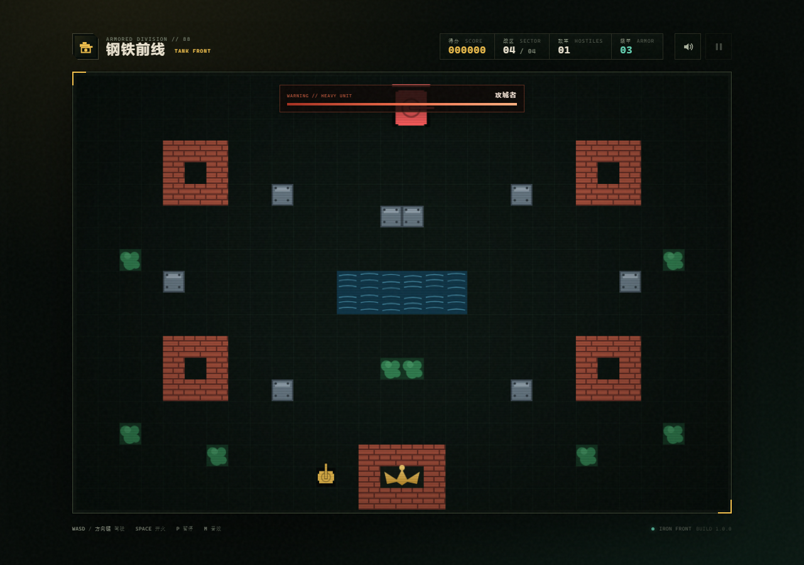

# 钢铁前线 · TANK FRONT

一款用纯 HTML5 Canvas 写的复古街机坦克大战。没有框架、没有构建步骤，双击 `index.html` 就能玩。

**在线试玩：** https://01wbh.github.io/tank-battle/



## 玩法

守住画面底部的鹰徽基地，驾驶主战坦克穿过四个战区，歼灭来袭的装甲集群。

| 操作 | 按键 |
| --- | --- |
| 驾驶 | `W A S D` 或 方向键 |
| 开火 | `空格` |
| 暂停 | `P` |
| 静音 | `M` |

手机上会自动显示虚拟摇杆和开火键。

## 特性

- **四个战区**，每关地图、敌军配置都不同
- **五类敌军**：侦察车、炮手、重装、狙击手，以及第四关的**重型攻城单位**（带独立血条）
- **可破坏地形**：砖墙能被打穿，钢块不行，水塘挡路、树林可穿行
- 基地被击毁或装甲耗尽即失败，通关四个战区即胜利
- 分数、最高纪录（localStorage 本地保存）
- WebAudio 合成音效，无需任何音频文件

## 本地运行

直接双击 `index.html`；或者在目录里起个静态服务器：

```bash
python -m http.server 8000
# 然后访问 http://localhost:8000
```

## 目录

```
index.html    页面结构、HUD、菜单与结算界面
styles.css    界面样式（复古街机风）
game.js       游戏逻辑：地图、坦克、子弹、AI、渲染
screenshot.png
```

## 说明

- 纯前端实现，无依赖、无外链资源，可离线运行。
- 游戏逻辑与渲染都集中在 `game.js`，通过 `window.TankFront.state` 可以拿到运行时状态，方便调试或二次开发。